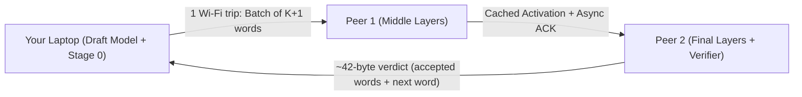

# ClustUp — Fault-Tolerant Peer-to-Peer LLM Inference

> **Turn everyday laptops and PCs on the same Wi-Fi into a private, fast, and crash-proof AI powerhouse — no cloud bills, no data leaving your room, no 40 GB downloads on every laptop, and no broken answers when someone closes their lid.**

**ClustUp** is a cross-platform, zero-configuration desktop app and headless daemon written in **Rust**. It pools the spare memory and compute of nearby Macs, Windows PCs, and Linux machines over ordinary home or campus Wi-Fi to run large open-source AI models (like **Qwen2.5-32B** or **Llama-3.3-70B**) that no single laptop could run alone.

---

## What is ClustUp? 

Today, if you want to use a genuinely smart AI assistant, you usually face an unfair trade-off:

1. **Use a cloud service (ChatGPT, Claude, etc.):** Your private notes, code, and documents leave your computer and go to third-party servers, and you pay recurring fees.
2. **Run an AI locally on your own laptop:** It's 100% private and free — *except* the smartest open-source AI models need 20–50+ GB of memory. A typical student laptop can only fit small, noticeably weaker models.

**ClustUp gives you a third option.**  
Instead of buying an expensive workstation, ClustUp lets you **link together the laptops already sitting in your dorm, lab, or living room**. It splits one large AI model across everyone's machines so they act like a single brain — while keeping your data encrypted on your local Wi-Fi.

Unlike existing experimental tools that only work in data centers, ClustUp is built for **real life**:
* **Fast over normal Wi-Fi** (not just fiber-optic lab cables).
* **Survives sudden disconnects** when a friend's laptop sleeps or loses signal.
* **Lightweight & easy to install** (~20 MB native app — no Python environments, no config files, no manual IP addresses).
* **Smart storage:** A 16 GB laptop never has to download a whole 42 GB AI file — it only downloads the small slice it is responsible for.

---

## The Three Problems ClustUp Solves

Pooling everyday laptops over Wi-Fi usually fails for three reasons:

1. **The Wi-Fi Latency Wall (Painfully Slow Typing):**  
   Standard distributed AI works like an assembly line, passing data from Laptop A → Laptop B → Laptop C **for every single word**. Over home or campus Wi-Fi, those constant back-and-forth trips add up, slowing responses to a crawl.
2. **Everyday Hardware Fragility (One Disconnect Ruins Everything):**  
   Laptops aren't servers. Batteries die, lids close, and Wi-Fi hiccups happen. In a normal peer-to-peer chain, **every device is a single point of failure** — if one friend walks away mid-answer, the entire response crashes and you start over.
3. **Storage & Setup Friction (Too Hard for Normal People):**  
   Forcing every student to manually edit IP configs, install multi-gigabyte Python/CUDA stacks, or download a full 40 GB model file onto a cramped SSD makes distributed AI impractical outside a research demo.

---

## How ClustUp Works

Rather than trying to magically make campus Wi-Fi faster or laptops more reliable, **ClustUp is engineered around real-world consumer networks**:

### 1. Distributed Speculative Decoding *(2.4×–3.2× Faster Over Wi-Fi)*
> **Think of it like a fast junior writer working with a panel of senior editors.**

* Your own laptop runs a **tiny, super-fast "draft" AI** (e.g., `0.5B–1.5B` parameters).
* Instead of sending one word across Wi-Fi at a time, your laptop rapidly guesses a burst of **5 to 8 upcoming words** locally and sends the whole batch across the swarm in **one single trip**.
* The other laptops holding the **big "target" AI** check all of those guessed words **at the exact same time** in parallel.
* At the end of the chain, the final peer runs **mathematically exact rejection sampling** and sends back a tiny **~42-byte** verdict.
* **Exact Same Quality:** Any guessed words the big AI agrees with appear immediately; at the first disagreement, the big AI's own word is used. The output matches what the big model alone would produce.
* **Self-Adjusting Speed:** An **Adaptive Depth Controller** watches how often guesses are accepted and automatically tunes how many words to draft — even turning drafting off (`K = 0`) if a tricky prompt makes drafting unhelpful.



### 2. Three-Tier Fault Tolerance *(Survives Closed Lids & Wi-Fi Drops)*
> **Think of it like a relay race with backup runners and saved checkpoints.**

* **Smart Heartbeats (Phi Accrual Detector):** Peers exchange tiny heartbeats over **QUIC datagrams** (which never get stuck behind big data packets). ClustUp ignores brief 500–600 ms Wi-Fi hiccups, yet detects a real disconnect in **~1.3–1.6 seconds**.
* **Overlapping Standby Layers:** When the swarm has spare memory, ClustUp places backup copies of each peer's layers on its neighbor.
* **Activation Caching & Incremental Checkpoints:** Peers briefly keep their recent outputs in memory and periodically send tiny, LZ4-compressed snapshots of the conversation memory (KV cache) to their standby peer in the background.

When a peer disappears mid-sentence, ClustUp escalates cleanly across **3 Tiers**:

| Tier | Situation | What Happens | User Experience |
| :--- | :--- | :--- | :--- |
| **Tier 1: Hot Standby** | A backup peer already holds the lost layers + recent checkpoint. | Upstream peer forwards its cached output straight to the standby peer, which takes over in `< 1 ms`. | **~1.4–1.8s brief pause.** Zero lost text, zero errors. |
| **Tier 2: Warm Re-Plan** | No hot standby exists, but remaining devices still have enough combined RAM. | Remaining peers automatically re-split the model, pull needed slices from local/LAN cache, and replay from checkpoints. | **3–12s rebalance.** Shows a subtle *"Rebalancing swarm..."* pill; zero lost text. |
| **Tier 3: Graceful Degradation** | Too few devices remain to fit the big model. | Generation pauses cleanly with 100% of generated text preserved. | One-click choice: **wait for peer to reconnect** or **continue with your local draft model**. |

### 3. Zero-Config Pooling, Sparse Downloads & Dorm-Safe Security
* **3-Layer Auto-Discovery:** Automatically finds nearby laptops via **mDNS**, falls back to **LAN UDP broadcast**, and includes a **1-click QR Code / Join Link** so it even works on strict university Wi-Fi routers that block multicast.
* **Hardware-Aware Splitting:** At startup, each peer measures its available RAM/VRAM (respecting a user-set **RAM Cap slider** and **battery auto-pause**) plus a quick 300 ms speed test so faster machines take more layers.
* **Sparse GGUF Downloading (No 40 GB Downloads per Laptop):** Instead of downloading an entire model file, each laptop fetches **only the exact byte ranges** for its assigned layers directly from Hugging Face (or copies them over fast LAN from another peer).
* **End-to-End Encrypted on Shared Wi-Fi:** New peers join using a **time-limited 6-digit Pairing PIN** (protected by **SPAKE2**, preventing offline password guessing) or a 256-bit QR invite. Every prompt, tensor, and checkpoint travels over **Mutual TLS 1.3** — nobody else on dorm Wi-Fi can snoop on your chats.

---

## Key Features & Deliverables

ClustUp ships as **three integrated artifacts** from a single Rust workspace:

1. **`ClustUp Desktop` (macOS `.dmg`, Windows `.msi`/`.exe`, Linux `.AppImage`/`.deb`):**
   * **Chat Workspace:** Streaming markdown chat with live speed (`tok/s`), draft acceptance rate (`α`), and subtle failover notifications.
   * **Interactive Swarm Topology Map:** Live graph showing every connected device (`M3 Metal`, `RTX 4070 CUDA`, `CPU AVX2`), Wi-Fi latency, primary vs. standby layer bars, and a **"Simulate Disconnect"** button for live fault testing.
   * **System Tray & Guardrails:** Friends contributing spare RAM can minimize ClustUp to the tray with a **RAM Cap slider** and **auto-pause on low battery**.
   * **Live Benchmarking Dashboard:** Real-time charts comparing Speculative vs. Sequential speed, latency jitter, and one-click JSONL/CSV export.
2. **`clustup-node` Headless CLI & Docker Image:**
   * Lightweight terminal daemon for Linux lab PCs, home servers, WSL2, or Docker (`clustup-node join --pin 482910 --max-ram-gb 12`).
3. **Built-In OpenAI-Compatible Local API (`http://127.0.0.1:8420/v1`):**
   * Exposes `/v1/chat/completions` (with SSE streaming) and `/v1/models` so external apps like **VS Code (Continue)**, **Cursor**, **OpenWebUI**, and `curl` can immediately use your P2P swarm.

---

## Supported Model Pairs (Verified Catalog)

Speculative decoding requires the small draft model and big target model to speak the exact same "vocabulary" (shared tokenizer). ClustUp includes curated, pre-verified pairs:

| Swarm Setup | Combined Usable RAM | Local Draft Model | Sharded Target Model | Target Size (`Q4_K_M`) |
| :--- | :--- | :--- | :--- | :--- |
| **2-Laptop Starter** | 12–16 GB | `Qwen2.5-0.5B-Instruct` (~0.4 GB) | `Qwen2.5-7B` or `14B-Instruct` | 4.7 GB / 9.0 GB |
| **3–4 Laptop Dorm Swarm** | 24–50 GB | `Qwen2.5-0.5B / 1.5B-Instruct` | `Qwen2.5-32B-Instruct` | 19.9 GB |
| **Coding Swarm** | 24–36 GB | `Qwen2.5-Coder-1.5B-Instruct` | `Qwen2.5-Coder-32B-Instruct` | 19.9 GB |
| **Lab Powerhouse** | 48–64 GB | `Llama-3.2-1B-Instruct` (~0.8 GB) | `Llama-3.3-70B-Instruct` | 42.5 GB |

### Expected Real-World Performance (4 Laptops Running `Qwen2.5-32B` with 100% Hot Standby)
| Wi-Fi Condition (Per-Hop RTT) | Standard Sequential P2P | ClustUp Speculative (`K=7, α=0.78`) | Speedup |
| :--- | :--- | :--- | :--- |
| Clean Home Wi-Fi (`20 ms`) | `5.61 tok/s` | **`15.30 tok/s`** | **`2.73×`** |
| Typical Dorm Wi-Fi (`40 ms`) | `4.58 tok/s` | **`13.24 tok/s`** | **`2.89×`** |
| Congested Campus Wi-Fi (`60 ms`) | `3.87 tok/s` | **`11.66 tok/s`** | **`3.01×`** |
| Heavy Interference (`100 ms`) | `2.96 tok/s` | **`9.42 tok/s`** | **`3.19×`** |

---

## Technology Stack

ClustUp is engineered in **Rust** for native cross-platform speed, memory safety, and tiny ~20 MB installers — with zero Python runtime required in production.

| Subsystem | Technology | Why We Chose It |
| :--- | :--- | :--- |
| **Core Engine & Concurrency** | **Rust (Edition 2024)** + `tokio` | Isolated async networking + dedicated blocking inference thread so GPU work never stalls heartbeats. |
| **AI Inference Engine** | **Hugging Face `candle`** (`candle-core`, `candle-nn`) | Native Metal (macOS), CUDA (NVIDIA), and CPU (AVX2/NEON/Accelerate/MKL) with direct programmatic layer slicing and KV-cache control. |
| **P2P Transport & Security** | **`quinn` (QUIC v1/UDP)** + `rustls` (Mutual TLS 1.3) + `spake2` | Eliminates TCP Head-of-Line blocking on lossy Wi-Fi; uses BBR congestion control and encrypted, PAKE-authenticated peer pairing. |
| **Wire Format & Compression** | **`prost` (Protobuf)** + raw FP16/INT8 tensors + **`lz4_flex`** | Zero-copy binary activation framing with optional adaptive INT8 compression and fast LZ4 KV-cache checkpoints. |
| **Peer Discovery** | **`mdns-sd`** + LAN UDP Beacon + QR/Link Seed | Zero-config on home Wi-Fi, with automatic fallbacks for restrictive campus networks. |
| **Sparse Model Storage** | **`hf-hub`** + **`reqwest` (HTTP Range)** | Downloads only each peer's assigned GGUF layer byte ranges (and shares cached layers over LAN). |
| **Desktop App & UI** | **Tauri v2** + **React 19** + **TypeScript** + **Tailwind v4** | Uses the OS native WebView (saves 400–800 MB RAM compared to Electron) with zero-polling `tauri::ipc::Channel` streaming. |
| **Local API Gateway** | **`axum`** | Embedded OpenAI-compatible HTTP/SSE server bound safely to `127.0.0.1:8420`. |
| **Chaos Testing & Charts** | **Docker** + Linux **`tc netem`** + offline Python (`matplotlib`) | Reproducible Wi-Fi jitter/disconnect benchmarks and publication-grade evaluation plots. |

---

## Workspace Structure

```text
clustup/
├── proto/clustup.proto           # Canonical Protobuf wire protocol
├── crates/
│   ├── clustup-proto/            # Generated wire types
│   ├── clustup-core/             # Pure domain logic: Shard Planner, Phi Detector, Exact Speculative Sampler
│   ├── clustup-hardware/         # RAM, Metal, NVML CUDA & 300ms bandwidth micro-benchmark
│   ├── clustup-discovery/        # mDNS-SD, UDP LAN beacon & QR/URI peer join
│   ├── clustup-net/              # QUIC mesh, SPAKE2 pairing, Mutual TLS 1.3 & 4-class framing
│   ├── clustup-storage/          # Sparse HTTP-Range GGUF virtual reader & LAN blob cache
│   ├── clustup-inference/        # Candle ShardedTransformer, DraftEngine & LZ4 KV checkpoints
│   ├── clustup-orchestrator/     # Tokio Actors: Coordinator, SpeculativeDriver, Router & 3-Tier Failover
│   └── clustup-api/              # Embedded Axum OpenAI-compatible gateway & JSONL telemetry
├── apps/
│   ├── clustup-desktop/          # Tauri v2 host + React 19 UI (Chat, Swarm Graph, Metrics)
│   └── clustup-cli/              # Headless `clustup-node` daemon & CLI benchmark runner
└── benchmarks/                   # Docker `tc netem` Wi-Fi chaos harness & Matplotlib plot scripts
```

---

## Roadmap & Milestones (Nov 2026 – Feb 2027)

* **Milestone 1 — Core Mesh & 2-Device Baseline (Weeks 1–5):** Rust workspace, QUIC TLS 1.3 mesh, SPAKE2 pairing, mDNS discovery, hardware profiler, Phi Accrual heartbeats, `CandleShardEngine` layer slicing, and a live 2-laptop Wi-Fi demo.
* **Milestone 2 — Auto-Pooling & Distributed Speculative Decoding (Weeks 6–9):** Memory/compute-weighted planner for 3+ peers, Sparse HTTP-Range GGUF downloader, local draft model, batched `K+1` verification, exact exit-node rejection sampling, and Unbiased-MLE Adaptive $K^*$ controller.
* **Milestone 3 — Fault Tolerance, Dashboard & Production Release (Weeks 10–13):** Checkpoint-pinned `ActivationCache`, async LZ4 KV replication, Tier-1/2/3 failover stress-tested with intentional disconnects, full React 19 Swarm Topology UI, OpenAI gateway, `tc netem` benchmarks, and cross-platform installers (`.dmg`, `.msi`, `.AppImage`).
* **Milestone 4 — Future Work (Post-Course):** Vulkan/WebGPU backend for AMD & Intel integrated GPUs, INT4 KV-cache quantization for 32K+ context windows, tree-based speculative drafting (EAGLE-2), and WAN overlay support (Iroh/Tailscale) for pooling across dorms.

---

## Honest Engineering & Known Limitations

We evaluate ClustUp transparently — including where distributed inference has natural limits:
* **Domain-Specific Draft Misses:** If a prompt is outside the small draft model's strengths (lowering acceptance rate `α`), speedups shrink; ClustUp's Adaptive Controller automatically drops to `K = 0` so it never runs slower than sequential inference.
* **Strict Campus AP Client Isolation:** Some enterprise Wi-Fi networks block *all* peer-to-peer LAN packets between clients (not just multicast). ClustUp documents instant local hotspot / portable router usage for those environments, with WAN relay planned for Milestone 4.
* **2× Memory for 100% Hot Standby:** Full instant Tier-1 failover requires enough combined swarm RAM to hold both primary and standby copies of every layer. When RAM is tighter, ClustUp transparently shows the exact **Standby Coverage %** (Amber badge) and falls back cleanly to Tier-2 Warm Re-Plan.

---

## Team & Academic Context

Developed as part of **Design Project-I (`SWE 4506`)** at the **Department of Computer Science and Engineering, Islamic University of Technology (IUT)**.

**Team 5:**
* **Mahmudul Hossain Samir** (`230042101`)
* **Ifham Bin Hossain** (`230042112`)
* **Shaikh Muhaiminul Hasan** (`230042113`)

**Academic Supervisor:**
* **Dr. Mohayeminul Islam** — Assistant Professor, Department of CSE, IUT